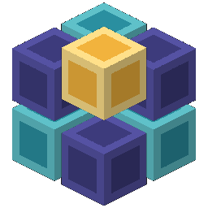
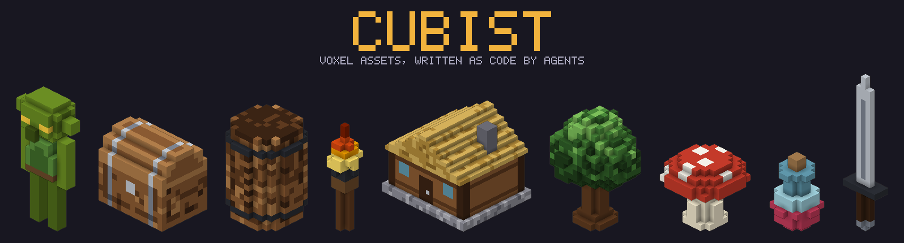
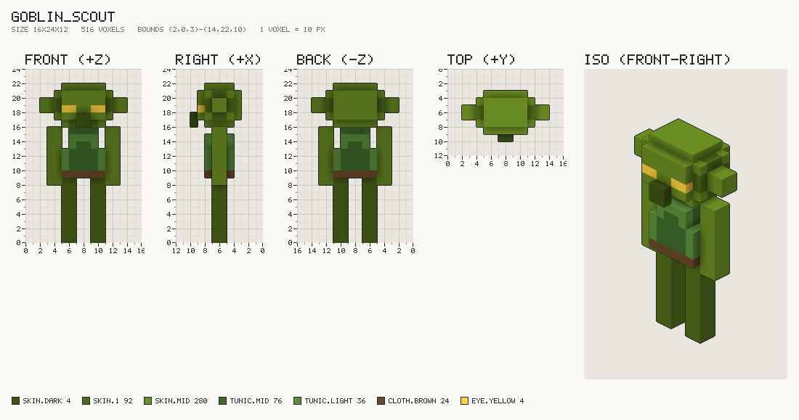
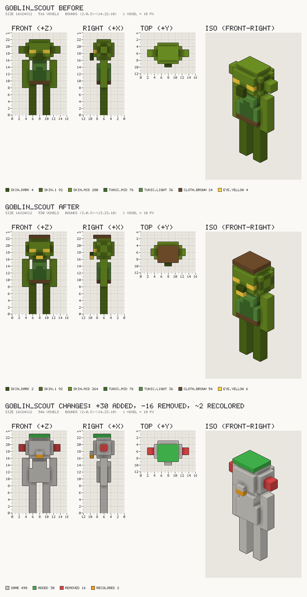

<p align="center">
  
</p>

<h1 align="center">Cubist</h1>

<p align="center"><b>Voxel assets, written as code by agents.</b></p>

<p align="center">
  
</p>

Cubist is a headless voxel modeling toolkit for AI agents. An agent writes a short Python
script, Cubist turns it into voxels, renders a contact sheet the agent can look at, checks it
against your game's style bible, and exports MagicaVoxel `.vox` and engine-ready `.glb` files.
The agent never places voxels by hand: it writes code, looks, and revises.

```python
from cubist import *


@asset(name="barrel", size=(12, 16, 12), tags=["prop", "wood"], grounded=True)
def barrel(p):
    body = lathe(profile=[(0, 5), (3, 6), (13, 6), (16, 5)], color=p.wood.mid).at(6, 0, 6)
    body = body.hollow(1).union(cylinder(r=5, h=1, color=p.wood.dark).at(6, 15, 6))
    for y in (2, 13):
        body = body.paint(p.metal.dark, where=band(axis="y", at=y, height=1))
    body = body.dither(p.wood.ramp, seed=1).darken_crevices()
    return Model(parts=[Part("body", body, pivot=(6, 0, 6))])
```

## What you get

- **A shape DSL built for agents.** Primitives (box, sphere, cylinder, cone, capsule, torus,
  wedge, lathe, extrude, heightmap), CSG with smooth blends, transforms, mirroring, voxel
  morphology (round, chamfer, hollow), paint ops (gradients, dithering, crevice shading, edge
  highlights), and selections. Colors come from named palette ramps, never indices.
- **Eyes for the agent.** Every build renders front, side, back, top, and iso views with
  voxel-coordinate rulers and a palette legend, so feedback can be exact. ASCII slices and
  before/after diffs cover the details.

  

- **A style bible.** One `style.toml` per game fixes the palette, scale, budgets, and art rules,
  and the linter holds every asset to it: off-palette colors, out-of-bounds voxels, floating
  pieces, broken symmetry, budgets, thin walls, hidden interiors.
- **Game-ready export.** `.glb` with one node per part at its pivot (lids open, arms swing),
  sockets as empty nodes, a palette texture or vertex colors, and optional baked AO, tested by
  importing into Godot 4. `.vox` keeps the part hierarchy for touch-ups in MagicaVoxel or Goxel.
  Everything else goes through vengi.
- **Agent integration.** A `CLAUDE.md` workflow and Claude Code skills, an MCP server for other
  clients, a library of approved examples for few-shot references, and an evaluation harness.
- **Deterministic.** The same script and seed give the same bytes, every time, on any machine.

## Install

Python 3.11+ and [uv](https://docs.astral.sh/uv/):

```sh
git clone ssh://git@192.168.50.249/kalcode/voxel-auther-system.git
cd voxel-auther-system
uv sync
```

Optional: [MagicaVoxel](https://ephtracy.github.io/) or [Goxel](https://goxel.xyz/) to view and
edit `.vox` (`brew install --cask magicavoxel goxel`), [Godot 4](https://godotengine.org/) for the
`.glb`, and [vengi](https://vengi-voxel.github.io/vengi/) for other formats.

## Run it

```sh
cd projects/demo
uv run cubist build assets/goblin.py            # out/goblin_scout/: .vox, contact.png, lint
uv run cubist diff out/goblin_scout             # what changed since the last build
uv run cubist render out/goblin_scout --slices y=18..19
uv run cubist export out/goblin_scout --ao      # export/goblin_scout.glb and .vox
```

The full walkthrough is in [docs/getting-started.md](docs/getting-started.md).

## Let Claude make the assets

Open [Claude Code](https://claude.com/claude-code) in the repo and ask like an art director.
The `CLAUDE.md` workflow and the skills in `.claude/skills/` take it from there: read the brief
and similar examples, write the script, build, look, critique, revise (at most five times), and
show you the result.

| You want to | Say something like | Skill |
| --- | --- | --- |
| Create | "Make a wooden signpost with two arrows and moss at the base, about goblin height." | `voxel-create` |
| Edit or refine | "The goblin's ears look like nubs; make them longer and pointier." | `voxel-refine` |
| Get ideas | "Suggest ten props for a blacksmith's yard and write briefs for the best five." | `voxel-ideas` |
| Start a game | "Set up a snowy mountain project from this Lospec palette." | `voxel-project` |

Every revision comes with a diff sheet: added voxels green, removed red, recolored orange.



More in [docs/working-with-claude.md](docs/working-with-claude.md). Other MCP clients can use the
same tools: `claude mcp add cubist -- uv run --directory "$PWD" cubist mcp --project
projects/demo` ([docs/mcp.md](docs/mcp.md)).

## Docs

| | |
| --- | --- |
| [Getting started](docs/getting-started.md) | Install, first asset, commands, new projects |
| [Working with Claude](docs/working-with-claude.md) | Creating, editing, refining, and brainstorming with an agent |
| [How it works](docs/how-it-works.md) | Architecture, build pipeline, shape stages, lint, export (with diagrams) |
| [MCP server](docs/mcp.md) | Setup and tool reference |
| [Design](docs/design.md) | The design of record: decisions, DSL reference, milestones |

## Project layout

```text
cubist/            the package: core, dsl, build, render, lint, io, export, mcp_server, cli
projects/demo/     a sample game: style.toml, briefs, asset scripts, examples/ (the library)
projects/eval/     20 briefs used to evaluate agents end to end
.claude/skills/    Claude Code skills: voxel-create, voxel-refine, voxel-ideas, voxel-project
docs/              guides, the design doc, and images (scripts/make_images.py regenerates them)
tests/             the test suite; golden/ holds reviewed contact sheets
```

## Status

Milestones 1–5 of the [design](docs/design.md) are done; milestone 6 (evaluation) is running.
Next up: animation, voxel effects, and engine integration.

Development: `uv run pytest` (Godot on PATH enables the GLB import test) and
`uv run ruff check . && uv run ruff format .`.
