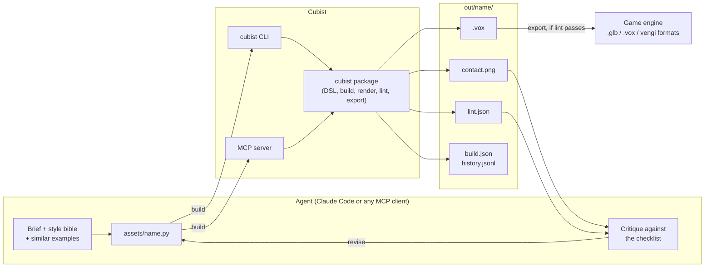
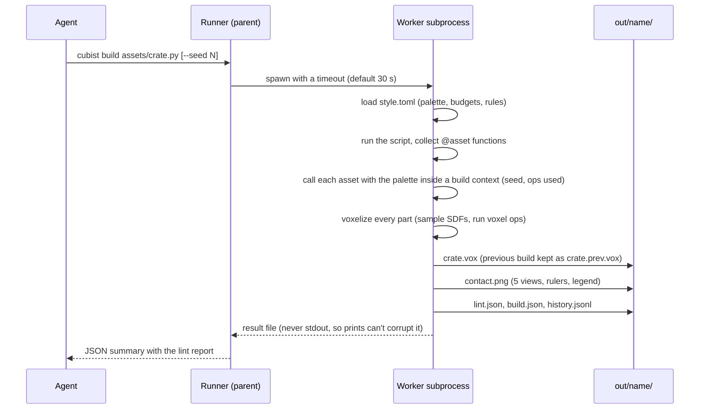
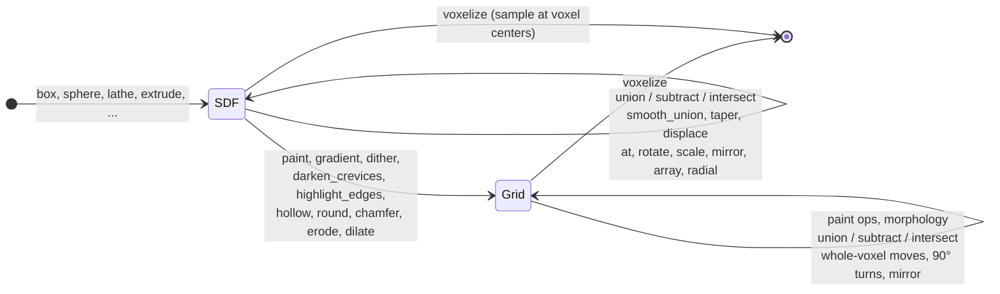
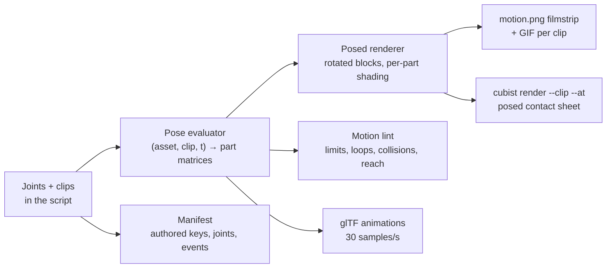
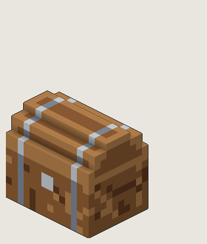
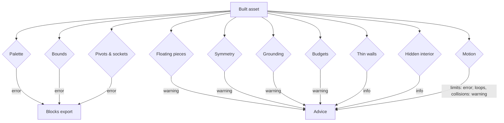
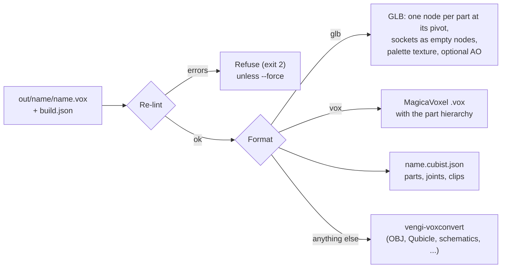

# How Cubist works

Cubist turns a short Python script into a voxel asset, shows the agent what it built, and
checks it against the project's style. The agent never places voxels by hand: it writes code,
looks at renders, and revises. This page walks through the moving parts.

## The big picture



The CLI and the MCP server are thin wrappers over the same functions, so anything one can do
the other can too.

## What happens in a build



The parent never imports the script; a runaway script times out instead of hanging the agent.
`--check-determinism` runs the worker twice and compares the bytes.

## Shapes: distance fields first, voxels second

Every primitive is a signed distance field (SDF). CSG, transforms, taper and displace combine
fields cheaply and exactly. Anything that has to look at voxels (painting, hollowing, rounding,
heightmaps) samples the field into a grid and continues there.



A voxel is filled when its center is inside a shape or exactly on its surface. Union gives
overlaps the later shape's color; subtract and intersect keep the left shape's colors. Ops
that need a distance field (`smooth_union`, `taper`, `displace`) refuse grid-stage shapes with a
message to apply them before painting.

## Coordinates

```text
        +Y (up)
         |
         |
         +------ +X (right)
        /
       /
     +Z (front, toward the viewer)
```

Y-up, right-handed, integer voxel cells. The origin is the asset's bottom-left-back corner.
The `.vox` writer converts to MagicaVoxel's Z-up; the GLB stays Y-up like glTF and is scaled by
the style bible's `voxel_size_m`.

## What the agent sees

Every build writes one contact sheet: front, right, back and top views at one pixel scale, with
voxel-coordinate rulers, plus a 3/4 iso view and a legend of palette names. The agent can say
"the left ear at x = 2..3, y = 18..19 is too thin" and find it in the script.


For exact work on small regions, ASCII slices print a layer per block, one letter per palette
color:

```text
$ cubist render out/goblin_scout --slices y=18
legend: . = empty, a = skin.mid, e = eye.yellow

y=18  (rows: z, back to front; columns: x)
    0    5    10   15
 3  ....aaaaaaaa....
 5  ..aaaaaaaaaaaa..
 8  ....aeeaaeea....
```

Revisions come with a before/after/changes sheet (`cubist diff`): added voxels green, removed
red, recolored orange.


## Motion

Parts can carry joints (`hinge`, `slide`, `spin`) and models can carry clips. One evaluator
turns (asset, clip, time) into a transform per part, and everything that shows or exports motion
reads from it, so what the agent sees is what an engine plays:



The posed renderer meshes each part once, transforms its faces, and rasterizes them at pixel
centers with the static renderer's projections, lights and outlines, so moving parts look like
solid blocks turning, never a re-voxelized staircase.



## Lint: what renders hide



Errors block `cubist export` unless `--force`. Determinism is checked on demand in CI.

## Export



GLB meshes are greedy-meshed with sealed cavities dropped, so only faces you can see are
exported. Parts become nodes at their pivots, parented like the model, so an engine can rotate
an arm or open a lid with no extra setup, and clips become glTF animations. The import is tested
in headless Godot 4, and animations in headless Blender. The manifest
([manifest.md](manifest.md)) carries what glTF can't: joint limits, authored keys, events.

## Module map

| Module | Does |
| --- | --- |
| `cubist/core` | Voxel grids, palettes, the style bible, parts and models, topology (what is visible) |
| `cubist/dsl` | Primitives, CSG, transforms, voxel morphology, paint ops, selections, seeded noise |
| `cubist/build` | Runs scripts in a subprocess; writes outputs and history |
| `cubist/render` | Rasterizer, posed renderer, contact sheets, filmstrips and GIFs, ASCII slices, diff sheets, bitmap font |
| `cubist/motion` | Joints, clips, and the pose evaluator |
| `cubist/lint` | The checks above and the report |
| `cubist/io` | `.vox` reader/writer, greedy meshing, GLB writer, vengi bridge |
| `cubist/export.py`, `manifest.py` | Lint-gated export and the engine manifest |
| `cubist/project.py`, `examples.py` | Briefs, scaffolding, the example library |
| `cubist/evaluation.py` | The brief-by-brief evaluation report |
| `cubist/mcp_server.py` | MCP tools over the same functions |
| `cubist/cli.py` | The `cubist` command |

The DSL reference is [dsl.md](dsl.md); the design of record, with every decision, is
[design.md](design.md).
