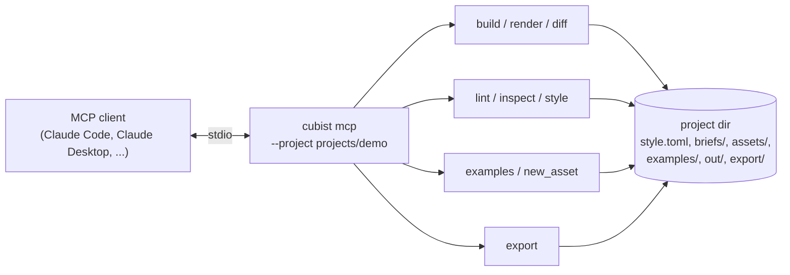

# MCP server

Cubist ships an MCP server with the same functions as the CLI, for agents and clients that speak
the Model Context Protocol. Renders come back as inline images, so the agent sees them without
opening files. There is deliberately no tool for placing or deleting single voxels.



## Register it

Claude Code:

```sh
claude mcp add cubist -- uv run --directory /path/to/voxel-auther-system cubist mcp --project projects/demo
```

Any client that takes a JSON config:

```json
{
  "mcpServers": {
    "cubist": {
      "command": "uv",
      "args": ["run", "--directory", "/path/to/voxel-auther-system",
               "cubist", "mcp", "--project", "projects/demo"]
    }
  }
}
```

`--project` is the directory with `style.toml`; everything the tools read and write stays inside
it. The server sends the authoring workflow (brief, examples, build, critique, revise, at most
five iterations) as its instructions.

## Tools

| Tool | Arguments | Returns |
| --- | --- | --- |
| `build_asset` | `script_path`, or `code` + `name`; `seed` | Lint summary, output paths, contact sheet image |
| `render` | `asset`, `views`, `slices` | Contact sheet image and/or ASCII slices |
| `diff` | `asset` | Before/after/changes image against the previous build |
| `lint` | `asset` | Lint report (JSON) |
| `inspect` | `asset` | Parts, bounds, pivots, sockets, colors (JSON) |
| `export` | `asset`, `formats`, `force`, `ao`, `vertex_colors` | Written paths (JSON) |
| `get_style_bible` | | Palette names and hex, scale, budgets, rules (JSON) |
| `search_examples` | `tags`, `category`, `limit` | Each example's note and script, plus its contact sheet |
| `new_asset` | `name`, `category`, `tags`, `description`, `must_haves`, `size` | Brief and stub paths |

`asset` is a name (`crate` means `out/crate/`) or a path. With `code`, the script is saved to
`assets/<name>.py` before building.

Errors come back as tool errors carrying the real message, written for the agent to act on:

```text
build_asset(code=..., name="crate")
-> error: crate.py: asset 'crate' failed:
     File ".../assets/crate.py", line 6, in crate
       return box((4, 4, 4), color=p.wod.mid)
                                   ^^^^^
   cubist.core.palette.PaletteError: unknown color wod. Did you mean wood? Known: wood, metal, ...
```

The server is built on the official MCP Python SDK (2.x, `MCPServer`).
