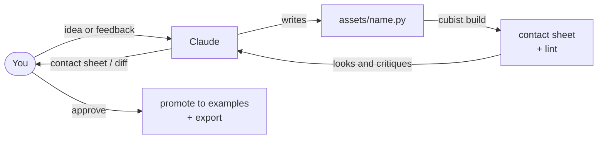

# Working with Claude

Cubist is built for an agent to drive. In Claude Code, the repo's `CLAUDE.md` and the skills in
`.claude/skills/` teach Claude the workflow: read the brief and similar examples, write a
script, build, look at the contact sheet, critique, and revise, at most five times. You direct;
Claude does the modeling and shows you the result.

Start Claude Code in the repo (`claude`), and talk to it like an art director.

## Create

Describe what you want, where it goes, and what must be true about it. Claude scaffolds the
brief, finds similar approved examples, and iterates.

> Make a wooden signpost for the demo village: two arrows pointing different ways, a little
> moss at the base, about as tall as the goblin.

> Create a treasure chest variant that's open, with gold coins spilling out. Reuse the chest's
> script.

Good requests name the category (prop, character, building, creature), rough size or a
reference ("as tall as the goblin"), and two or three must-haves you'd check on the contact
sheet. The `voxel-create` skill handles the rest.

## Edit and refine

Point at what you see. The rulers on every view give exact coordinates, so you can be precise,
but plain words work too.

> The goblin's ears look like nubs. Make them longer and pointier.

> On the hut, the chimney at x = 17..19 is too short. Raise it two voxels and darken the top.

> The barrel feels too uniform. More contrast between the planks, and make the hoops lighter.

Claude edits the script (never the voxels), rebuilds, and shows a diff sheet: added voxels
green, removed red, recolored orange. Small requests give small diffs, which are easy to review.
This is the `voxel-refine` skill.

## Make it move

Describe the motion the way you'd direct it. Claude adds joints and clips to the script, builds,
reads the filmstrip (iso frames over a side view, each with its time), checks the motion lint,
and sends you the GIF.

> Make the chest lid open with a little bounce, and close with a thud.

> The goblin needs a walk cycle and an idle where it looks around.

> When the blaster fires: kick the muzzle up, snap the slide back, and flash for two frames.

Feedback on timing works like feedback on shape: "the door swings too slowly", "the arms
should swing less". This is the `voxel-animate` skill.

## Get ideas

Ask for sets, variations, or gaps. Claude reads the style bible and what already exists, then
proposes briefs; nothing gets built until you pick.

> We need props for a blacksmith's yard. Suggest ten, and write briefs for the five you think
> will read best at game distance.

> Give me three variations of the crate: broken, stacked, and with a tarp.

This is the `voxel-ideas` skill. To set up a new game's palette and rules, ask for that too
(`voxel-project`):

> Start a new project for a snowy mountain level. Import this Lospec palette and build ramps for
> ice, pine, stone, and fur.

## Approve, export, and evaluate

> I like the signpost. Promote it with a note on what makes it good, then export it.

Promoted assets join `examples/`, so later assets get better references. Exports land in
`export/` as `.glb` (one node per part at its pivot, ready to animate in an engine) and `.vox`.

To see how a whole batch went, `cubist eval` writes `eval/report.md` and a gallery; score each
asset 1–5 in `eval/scores.toml` and run it again.

## Tips

- **Iterate in small steps.** "Make it chunkier" is fine, but "the legs at y = 0..8 are too
  thin" converges faster.
- **Ask for slices** when a detail matters: "show me the face layers" gets
  `cubist render --slices`.
- **Hand edits.** You can touch up an export in MagicaVoxel, but the script stays the source of
  truth; tell Claude what you changed so it can fold it into the script.
- **Limits.** Organic shapes over about 32 voxels (faces, creatures) are the hardest; expect
  more iterations or a hand touch-up.

## Other clients (MCP)

Any MCP client can use the same tools. See [mcp.md](mcp.md).
