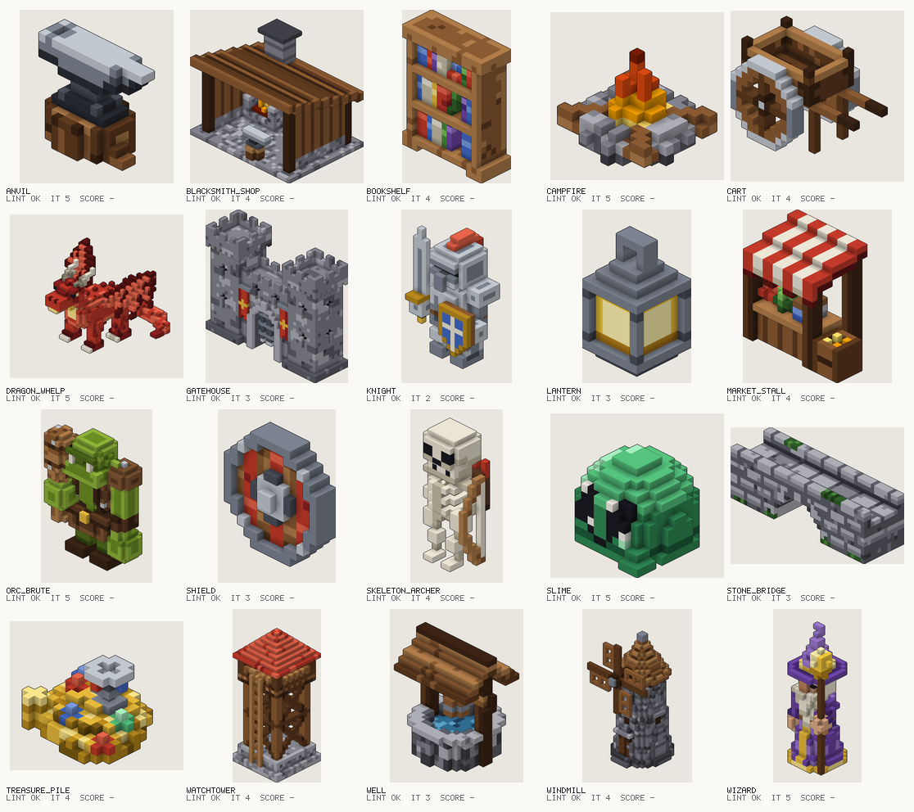

# Milestone 6 evaluation: agent notes

Four fresh Claude agents each took five briefs from `projects/eval/briefs/`, with only
`CLAUDE.md`, `docs/design.md`, and the CLI to go on, and the demo example library for
references. They worked in parallel on 2026-10-24 against commit `3e8cf9f`.

## Baseline (the system as the agents used it)

| Measure | Result |
| --- | --- |
| Briefs built | 20 / 20 |
| Final builds with no lint errors or warnings | 20 / 20 |
| Within 5 iterations | 20 / 20 |
| Mean iterations | 3.95 |
| Agent self-score (1–5) | mean 3.7; 15 at 4, 5 at 3 |
| Human score | pending: fill in `scores.toml`, then `uv run cubist eval --project projects/eval` |

Caveats: failed builds weren't logged then, so attempts are a little higher than the iteration
counts (agents reported 6 failed builds in all); watchtower's count includes one rebuild caused by
an accidental `ruff format` of the scripts mid-run (its real count is 3). Re-running `cubist eval`
today re-lints with the newer overlap check, which flags 5 multi-part characters whose parts share
voxels; that is new information, not a regression.

## Per asset (agent self-assessment)

| Asset | It. | Self | Still falls short (agent's words, condensed) |
| --- | --- | --- | --- |
| lantern | 3 | 4 | Boxy outline, no taper; square hanging ring; 1-voxel posts |
| watchtower | 3 | 4 | Roof ends in a 2x2 top (even width); ladder outside the floor |
| knight | 2 | 4 | Crossguard runs front-to-back; long sword; short legs; uniform highlights |
| campfire | 5 | 3 | Flame small and partly hidden by logs; few embers |
| slime | 5 | 3 | Rectangular eyes read as a mask; body less translucent than intended |
| anvil | 5 | 4 | Little stump ring showing; busy stump sides |
| blacksmith_shop | 4 | 4 | Small fire; roof reads as planks; plain interior |
| orc_brute | 5 | 3 | Parts share 60 voxels; boxy head; club reads as a log |
| shield | 3 | 4 | Boss is a stepped square at 14 px; plain back |
| stone_bridge | 3 | 4 | Regular, repeating masonry; blunt ends |
| bookshelf | 4 | 4 | Leaning book stair-steps; frame dither looks like holes |
| windmill | 4 | 3 | Sails short inside the 24-wide box; busy stone |
| wizard | 5 | 4 | Small face under the brim; orb reads yellow, not glowing |
| cart | 4 | 4 | 4 spokes only (8 filled in solid); thin handles |
| dragon_whelp | 5 | 3 | Short neck; noisy body banding; mottled wings |
| treasure_pile | 4 | 4 | Short goblet; identical gems; flat top |
| well | 3 | 4 | Blotchy masonry; heavy roof |
| market_stall | 4 | 4 | Awning hides goods in iso; goods are small blobs |
| skeleton_archer | 4 | 3 | Bow is a line from the front; skull a rounded box; stiff pose |
| gatehouse | 3 | 4 | Busy masonry; plain back; portcullis partly hidden |

## What the agents found, and what changed

| Report (agents) | Status |
| --- | --- |
| Uncolored cutters crash on painted shapes (all four) | Fixed: cutters are sampled for occupancy only, in both stages |
| Lazy errors name no script line or shape (all four) | Fixed: shapes record their creation line; errors name the primitive, line, and part |
| `line()` is 3 wide at 45°; steep lines only edge-connected (A, C) | Fixed: lines are voxel walks, face-connected by default, `connect=26` optional; `polyline` added |
| Failed builds missing from history (all four) | Fixed: failures are logged and count as iterations |
| Selections in CSG give an internal error (A) | Fixed: a clear error at the `-` call |
| `highlight_edges` lights all of a thin part (B, C) | Fixed: an axis open on both sides isn't an edge; `facing=` for light direction |
| `darken_crevices` shows through 1-voxel walls (D) | Fixed: horizontal crevices skip one-voxel walls |
| No lint for overlapping parts; voxel counts disagree (A, B, D) | Fixed: overlap warning; summary `voxels` is the merged count, `part_voxels` the sum |
| `examples search` with no criteria returns `[]` (C) | Fixed: lists the library |
| `inspect` rejects `out/<name>`, shows hex (B) | Fixed: accepts the directory, shows palette names |
| `render --views` overwrites `contact.png`; header cut off (B) | Fixed: writes `render.png`; sheets widen to fit the header |
| Iso panel has no margin (B) | Fixed |
| Symmetry warned twice for bare-shape assets (B) | Fixed |
| Thin-feature info is one useless box (B) | Fixed: lists the largest clusters |
| Symmetric assets centered on x.5 can't be declared (C) | Fixed: `symmetric=("x", 15.5)` |
| `cubist style` calls tables "ramps" (A) | Fixed: `ramps` vs `named` |
| Left/right undefined; goblin used the viewer's side (A, B) | Fixed: character's own side; goblin renamed |
| Doc gaps: rotate sign, faces names, half-open ranges, sockets, `where=`, signatures, `mid` index, gradient range (all four) | Fixed: `docs/dsl.md`, a full reference |

| Wish | Status |
| --- | --- |
| Masonry/brick/shingle paint (B, D) | Added: `masonry(ramp, block, mortar, seed)` |
| Stripes and checker selections (B, D) | Added: `stripes()`, `checker()` |
| Recess/inset op (D) | Added: `carve(cutter, color)` |
| Project a 2D pattern onto a surface (A) | Added: `decal(rows, colors, face, at)` |
| Tapered capsules (C) | Added: `capsule(..., r_end=)` |
| Thin plates for wings and sails (C) | Added: `panel(points)` |
| Pyramid / hip roof (A) | Added: `pyramid(size)` |
| Polyline and 6-connected lines (A, C, D) | Added |
| Gradient over an explicit range (A) | Added: `gradient(..., lo=, hi=)` |
| Symmetric dither (B) | Added: `dither(..., mirror=)` |
| Light-direction highlights (A, B, C) | Added: `highlight_edges(facing=)` |
| Rest one shape on another's surface (D) | Open |
| Per-axis or vertical-only `round` (D) | Open |
| Angular sector selection (B) | Open |
| Orthographic profile carve primitive (B) | Open (documented as a pattern: intersect extrusions) |
| Grip sockets with an axis (B) | Open; part of the animation work |
| Cone with a 1-voxel tip at whole-number centers (C) | Open (documented gotcha) |
