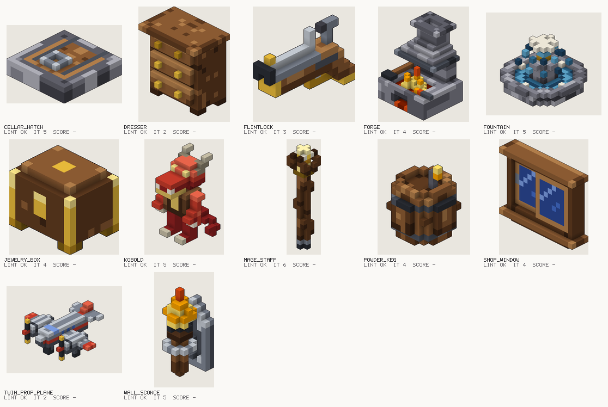

# Milestone 11 evaluation: motion

Twelve briefs, one for each of David's moments, on objects distinct from the demo examples.
Four fresh Claude agents each took three briefs. They had only `CLAUDE.md`, `docs/dsl.md`, the
`voxel-animate` skill, and the demo example library for references. They worked in parallel on
2026-10-24 against commit `9cea428` (milestones 7–10 plus the M7 review fixes; `f4952e5`, landed mid-run, only touched the eval report). An independent
reviewer read the M8–M10 code at the same time.

## Baseline (the system as the agents used it)

| Measure | Result |
| --- | --- |
| Briefs built | 12 / 12 |
| Final builds with no lint errors or warnings | 12 / 12 |
| Within 5 iterations | 11 / 12 (mage_staff took 6) |
| Mean iterations | 4.1 |
| Agent self-score (1–5) | mean 3.5; six at 4, six at 3 |
| Human score | pending: watch `eval/gifs/` (or the gallery page), fill in `scores.toml`, then `uv run cubist eval --project projects/motion` |

Iterations count distinct script versions built, failed builds included. Agents A and D spent
iterations on typos and on lint fix-ups without knowing either counted. The rules weren't
written down, which is fixed now: see below.

## Per moment

| Moment | Asset | It. | Self | What it does | Still falls short (agent's words, condensed) |
| --- | --- | --- | --- | --- | --- |
| Torch flickering | wall_sconce | 5 | 3 | 6-frame flame flipbook, glow, flickering light | Small blocky flame; some frames end in a 1-voxel stick; the torch hides the plate from the front |
| Chest opening | jewelry_box | 4 | 4 | Back-edge hinge pops to 118°, bounces, settles; a glint flashes; `close` slams with a rebound | 1-voxel lid shows its emblem underneath; the glint is a blob |
| Door opening | cellar_hatch | 5 | 4 | Trapdoor tugs, heaves past vertical and settles; `close` accelerates, slams, and kicks up dust | Nothing visibly holds it open; the 0.08 s tug only shows in the GIF |
| Window sliding | shop_window | 4 | 4 | Left pane slides behind the fixed one in a back track; `close` rebounds off the jamb | Reads as a generic window; no glass color in this palette |
| Desk drawer | dresser | 2 | 4 | Middle drawer is a real tray on a slide, open and close, no collisions | Plain sides; no bump at the stop |
| Goblin walking | kobold | 5 | 3 | Walk keeps feet flat, tail sways with a lagging tip, footsteps, travel; idle looks around and hisses | Boxy from the front; no knees or foot lift; short tail |
| Barrel exploding | powder_keg | 4 | 4 | 10 chunks thrown up and landing by 1 s, a 0.2 s fireball flipbook, 16 smoke puffs | No wind-up; smoke previews as clustered cubes |
| Gun shooting | flintlock | 3 | 3 | Hammer and frizzen on hinges, 2-frame hidden flash, -12° kick, smoke puff, oriented muzzle | Stubby grip; the flash is one flat layer |
| Wand casting | mage_staff | 6 | 3 | Wind back, thrust, overshoot; 18 sparks from the orb; a cast event; an idle orb pulse | Small orb partly hidden by the claw; the thrust is mostly a rotation |
| Water moving | fountain | 5 | 3 | Rings of cycling water flowing outward; a 4-frame splash of jet, crown and arcing drops | Flat crown; drops look like floating cubes; the splash flickers more than flows |
| Propellers spinning | twin_prop_plane | 2 | 4 | Two props spinning opposite ways on their hubs in a clean 0.5 s loop | Flat windshield; plain 2-blade props |
| Fire with smoke | forge | 4 | 4 | Masonry hearth, glowing coals, fire flipbook, flickering light, always-on chimney smoke | The stepped hood looks like a wedding cake and hides some fire |

## What the agents and the reviewer found, and what changed

| Report | From | Status |
| --- | --- | --- |
| `render --clip` can't see preview clips (`<part>_frames`, `colors`) | C, D, review | Fixed |
| `render --slices` and the eval gallery show later flipbook frames and hidden parts | D | Fixed: loaded assets fold frames, and thumbnails leave out hidden parts |
| `burst` trips its own floor check between keys | B | Fixed: keys are lifted wherever playback would dip |
| `emitter_blocked` on an explosion's emitter inside the keg | B | Fixed: only always-on emitters are checked |
| `mirrored()` keeps the original parent (foot_l stayed on leg_r) | A | Fixed: the parent side swaps, or pass `parent=` |
| `~shape` in `where=` crashes; `inside(selection)` gives an internal error | A | Fixed |
| `carve(color=)` shows through one-voxel walls | C | Fixed (the biplane's cockpit golden changed with it) |
| A script with no `@asset` isn't logged | D | Fixed |
| Build output is ~200 lines of JSON; no iteration count | A, B, D | Fixed: compact output with `iteration`; `--full` for everything |
| Iteration counting undocumented; typos cost iterations | A, B, D | Documented in `CLAUDE.md` and the skill; `cubist build --check` runs and lints without counting |
| No `joint()` helper for list-form clips | B, C | Added |
| `examples search` prints `[]` with no hint | B, C | A note says where examples live |
| Doc gaps: cycle direction, cycles hitting sprays, smooth easing at middle keys, hidden parts/frames vs size and overlap, `connect=26` floating, lights on hidden parts | B, C, D | Documented in `docs/dsl.md` |
| Stepped glTF keys landed one key late (float32 rounding) | Blender check | Fixed; found when the Blender check was widened per the review |
| A flipbook driven in one clip still loops in other clips' previews but not in the `.glb` | review | Fixed: it rests on frame 0 outside the clips that play it, and lint notes it |
| Duplicate `frames` tracks; frame keys past the last frame | review | Errors now |
| Default owners for emitters, lights and sockets could be hidden parts | review | Fixed (the demo blaster's sparks now hang from its frame) |
| Empty flipbook frames, `@` in part names, generator frames, dotted `[glow]` keys | review | Clear errors, or they work |
| Particle previews ignored the build seed; flipbook particles merged their frames | review | Fixed |
| Fast slides undersampled in the `.glb`; fracture stopped merging after an island | review | Fixed |
| A ten-chunk fast burst took over 30 s to build after the sampling fixes | rebuild | Fixed: about 4 s, with a test |

| Wish | From | Status |
| --- | --- | --- |
| A check that doesn't use an iteration | A, C | Added: `cubist build --check` |
| `burst` wind-up | B | Added: `burst(start=)` |
| Accelerating ease for slams | B | Added: `ease="in"` (and `"out"`) |
| `mirrored(parent=)` | A | Added |
| Iteration count in build output | D | Added |
| Per-part opt-out from color cycles | C | Open (documented workaround: paint effects from another ramp) |
| Foot-lift generator, tail-chain generator | A | Open |
| Emitters along an edge, emitter preview past the clip's end | A, C | Open |
| A "hit the stop" generator; marking `frame_pop` as intended | C | Open |
| A glass ramp in the motion palette | B | Open (a palette choice for this project) |

The agents' own notes are in `notes-a.md` to `notes-d.md`.
